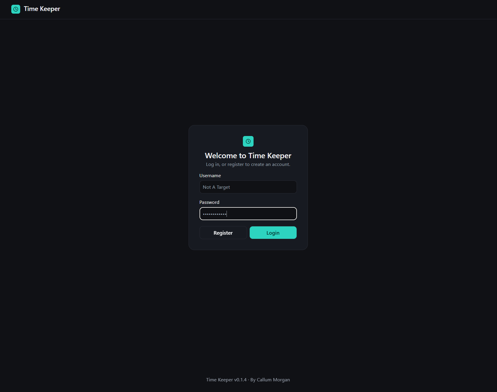
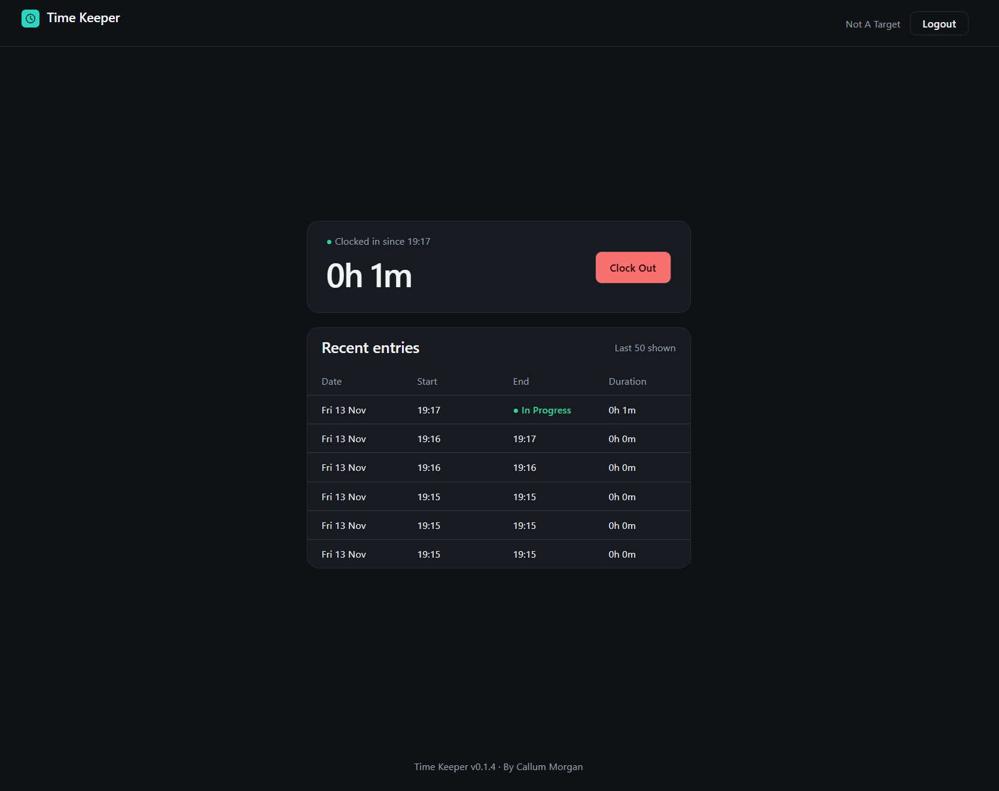

# Time Keeper

A small full-stack time-tracking app: clock in and out, and review your recorded time. Built as an independent personal project in my own time, with no code or data from any employer.




**Status:** work in progress (v0.1.4). Authentication and basic clock in/out are working. See the roadmap below.

## Stack

- **Front end:** React 19, Vite, React Router
- **Back end:** ASP.NET Core (.NET 10), C#, Entity Framework Core
- **Auth:** JWT access tokens, rotating hashed refresh tokens, BCrypt password hashing
- **Data:** EF Core in-memory provider (data resets whenever the server restarts)

## Features

- Register, log in and log out
- Clock in and out, with a list of recent entries and durations
- Input validation and per-IP rate limiting on the auth endpoints

## Project structure

```
time-keeper.Server/   ASP.NET Core API: controllers, services and EF Core models
time-keeper.client/   React front end (Vite)
```

## Getting started

Prerequisites: the [.NET 10 SDK](https://dotnet.microsoft.com/download) and [Node.js](https://nodejs.org) (LTS).

1. Clone the repo and install the client packages:

   ```
   git clone https://github.com/CMo95/time-keeper.git
   cd time-keeper/time-keeper.client
   npm install
   ```

2. Set the JWT signing key (any random string of 32+ characters; it is stored outside the repo):

   ```
   cd ../time-keeper.Server
   dotnet user-secrets set "Jwt:Key" "<your-random-key>"
   ```

3. Open `time-keeper.slnx` in Visual Studio and run the server project. It starts the Vite dev server through the SPA proxy, and a development HTTPS certificate is created with `dotnet dev-certs` the first time.

## API

| Method | Endpoint | Auth | Purpose |
| --- | --- | --- | --- |
| POST | /api/auth/register | No | Create an account |
| POST | /api/auth/login | No | Get an access and refresh token |
| POST | /api/auth/refresh | No | Exchange a refresh token for a new pair |
| POST | /api/auth/revoke | No | Revoke a refresh token (log out) |
| GET | /api/timeentries | Yes | List your recent entries |
| POST | /api/timeentries/clock-in | Yes | Start a new entry |
| POST | /api/timeentries/clock-out | Yes | End the current entry |

Swagger UI is available in development at `https://localhost:7216/swagger`.

## Known limitations

- The in-memory database loses all data on restart.
- Tokens are kept in `localStorage`, which is exposed to any XSS vulnerability.
- The client does not yet refresh an expired access token silently; it logs the user out.

## Roadmap

- Persistent storage (SQLite or SQL Server) with EF Core migrations
- Silent token refresh on the client
- Edit and delete entries, plus weekly totals
- Automated tests and a CI build

## Licence

MIT. See [LICENSE.md](LICENSE.md).
